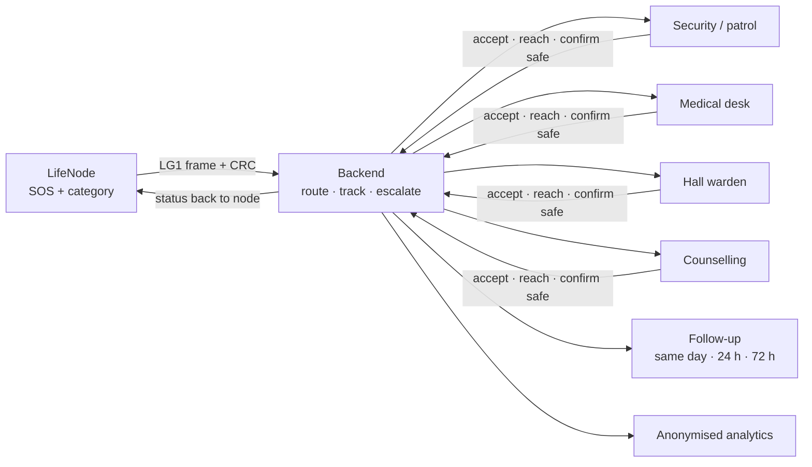
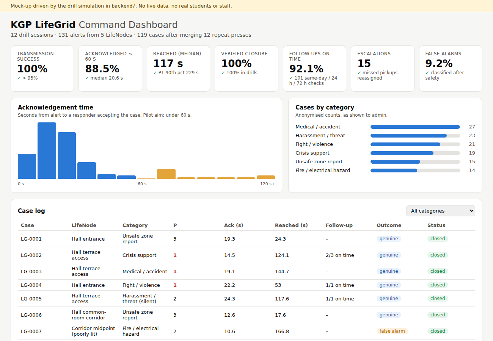

# KGP LifeGrid

[](https://github.com/S-blip-hub/kgp-lifegrid/actions/workflows/ci.yml)

**No-Life-Lost AIoT student safety infrastructure for residential campuses, starting with IIT Kharagpur.**

> No student unseen. No emergency unanswered. No preventable life lost.

LifeGrid combines physical **LifeNodes** (one-touch SOS points in halls, corridors and high-risk zones) with a **closed-loop response backend** that routes every alert to the right people with its exact location and keeps the case open until a person confirms the student is safe. Crisis cases also get same-day, 24-hour and 72-hour follow-up.

It is designed to strengthen the institute's existing systems (SETU, SARTH, security, the hospital and hall wardens), not replace them.

**Status: TRL 2, technology concept formulated.** This repository holds the concept documentation and the software for the pilot's routing simulation and dashboard mock-up. No LifeNode has been deployed and no real student data is used.

**Stack:** C++ (LifeNode logic) · TypeScript on Node.js (backend and drill simulation) · HTML, CSS, JavaScript (dashboard) · Make

## Documentation

| Document | Contents |
|---|---|
| [Concept note](docs/concept-note.md) | Mission, problem, solution, modules, deep-tech rationale |
| [Architecture](docs/architecture.md) | System diagram, components, frame format, routing rules |
| [Response flow](docs/response-flow.md) | Case lifecycle and a crisis-alert sequence |
| [Ethics, privacy and safety](docs/ethics-privacy.md) | Guardrails, role-based access, risk register |
| [Pilot plan and budget](docs/pilot-plan.md) | 90-day Safe Hall + Safe Corridor plan, metrics, Rs. 4.5 lakh budget |
| [References](docs/references.md) | Sources for campus scale, existing systems and prevention frameworks |



## What the software does

**`firmware/`: LifeNode logic in C++17.** Hardware-independent so it can be tested on a laptop before it goes onto a microcontroller.
- Category buttons must be held for 1.5 s, which stops accidental brushes from raising alerts; contact bounce is filtered.
- Each alert becomes a short frame with a CRC-8 checksum, e.g. `LG1;H1-N2;MED;17;0*6B`.
- Unacknowledged frames are re-sent with back-off (2, 4, 8, 16 s), then the node switches to an offline state that shows the intercom number while it keeps retrying every 30 s.
- The status ring follows the case: received, help on the way, closed. A tamper switch sends a silent hazard alert.

**`backend/`: routing and case lifecycle in TypeScript.**
- Frame parsing with checksum validation, using the same test vectors as the firmware.
- Category rules for priority, owner roles, notified roles, acknowledgement and reach limits, and follow-ups. Crisis and fight alerts from high-risk nodes are always priority 1.
- Nearest-available responder selection by travel time.
- A case book that merges repeat presses, escalates unacknowledged cases, queues cases when everyone is busy, and refuses to close a case before safety is confirmed and follow-ups are recorded.
- Role-based views (counselling notes stay with counselling; admin sees anonymised counts only).
- A drill simulator that produces the pilot metrics.

**`dashboard/`: command dashboard mock-up** for the control room, driven by the drill output.

## Drill simulation results

Twelve simulated drill sessions on the five pilot nodes (131 alerts, seed 7), with assumed responder behaviour: 8% of first pickups missed, 15% of alerts pressed twice, 10% false alarms.

| Pilot metric | Target | Simulated |
|---|---|---|
| Alert transmission success | > 95% | 100% |
| Acknowledgement | aim below 60 s | median 20.6 s, 88.5% within 60 s |
| Responder reaches the node | measured | median 117 s; priority-1 90th percentile 229 s |
| Verified closure | 100% in drills | 100% (119 of 119 cases) |
| Follow-ups within two hours of falling due | measured | 92.1% of 101 checks; all eventually completed |
| Repeat presses merged | every duplicate labelled | 12 |

These numbers test the workflow logic under assumed behaviour. They are not evidence of real-world performance; that comes from the volunteer drills in weeks 7–8 of the pilot.



## Running it

Requirements: a C++17 compiler and Make for the firmware tests; Node.js 20+ for the backend.

```bash
# LifeNode logic
cd firmware && make test

# backend: build, test, run a drill
cd backend
npm install
npm test
npm run drill -- --seed 7 --sessions 12    # writes outputs/ and dashboard/data.js

# dashboard
open dashboard/index.html
```

## Roadmap

1. Stakeholder review with security, counselling, hall and medical teams; privacy and SOP sign-off.
2. Bench LifeNode on a microcontroller board using `firmware/` as the core, with LoRa or Wi-Fi uplink and backup power.
3. Backend service around the case book, with encrypted logs, retention limits and authenticated responder apps.
4. Volunteer usability testing and mock drills, then a controlled demonstration and TRL 3/4 report.

## Author

Shrey Singh, B.Arch, Department of Architecture and Regional Planning, IIT Kharagpur. Founder, KGP LifeGrid.

## License

MIT for the code. The concept documents in `docs/` are © Shrey Singh.

If you or someone you know is struggling, please reach out to your campus counselling centre or a trusted person. In India, Tele-MANAS is available on 14416.
