# System architecture

Safety inputs enter through LifeNodes, authorised reports or approved integrations. The decision layer classifies urgency and category, routes the case to the right people and keeps it open until a human responder confirms safety. Only anonymised insights are used for long-term campus improvement.

```mermaid
flowchart LR
    subgraph IN["1 · Safety inputs"]
        A1["LifeNode SOS button"]
        A2["Fight / harassment / threat"]
        A3["Accident or medical emergency"]
        A4["Fire / electrical hazard"]
        A5["Care-circle concern"]
        A6["High-risk-zone trigger"]
    end

    subgraph PG["2 · Privacy guardrails"]
        P1["No chat or social-media reading"]
        P2["No cameras in rooms"]
        P3["Role-based responder access"]
        P4["Minimum data retention"]
        P5["Human approval for crisis action"]
    end

    subgraph DL["LifeGrid decision layer"]
        D1["Category and priority"]
        D2["Location-aware responder routing"]
        D3["Duplicate suppression"]
    end

    subgraph RN["3 · Response network"]
        R1["Security control room"]
        R2["Nearest patrol / guard"]
        R3["Hall warden / mentor"]
        R4["Medical emergency desk"]
        R5["Counselling / SARTH team"]
        R6["Authorised admin escalation"]
    end

    subgraph VC["4 · Verified closure"]
        V1["Responder accepts"] --> V2["Student located, help reaches"] --> V3["Safety confirmed"] --> V4["Closed with follow-up"]
    end

    IN --> PG --> DL --> RN --> VC
    VC --> AN["Anonymised safety analytics<br/>for lighting, access and design fixes"]
```



## Components in this repository

| Layer | Folder | What it does |
|---|---|---|
| LifeNode logic | `firmware/` | Category buttons with hold-to-send, debounce, alert frames with CRC-8, delivery retries with back-off, offline fallback, tamper alert. Hardware-independent C++ with host-side tests |
| Frame codec | `backend/src/frame.ts` | Parses and checks the frames LifeNodes send (`LG1;<node>;<category>;<seq>;<silent>*<crc>`) |
| Routing | `backend/src/routing.ts` | Category rules (priority, owner roles, roles notified, time limits, follow-ups) and nearest-available responder selection |
| Case lifecycle | `backend/src/lifecycle.ts` | Closed-loop case book: merging repeat presses, escalation, queueing when everyone is busy, safety confirmation, follow-ups, closure rules |
| Access control | `backend/src/access.ts` | Role-based views and anonymised analytics |
| Drill simulation | `backend/src/simulate.ts` | Pilot drill generator and metrics |
| Dashboard mock-up | `dashboard/` | Control-room view of a drill |

## Frame format

```
LG1;H1-N2;MED;17;0*6B
│   │     │   │  │ └─ CRC-8 (poly 0x07) of everything before '*', two hex digits
│   │     │   │  └─── silent flag (1 = no sound at the node)
│   │     │   └────── sequence number (0–65535)
│   │     └────────── category: MED FGT HAR HAZ CRS UNS
│   └──────────────── LifeNode id
└──────────────────── protocol version
```

## Routing rules

| Category | Priority | Takes ownership | Informed | Acknowledge within | Reach within | Follow-up |
|---|---|---|---|---|---|---|
| Medical / accident (MedAlert) | 1 | nearest patrol, then medical desk | control room, medical desk | 60 s | 8 min | – |
| Fight / violence (Raksha) | 1 | nearest patrol | control room, warden | 60 s | 7 min | 24 h |
| Crisis support (Jeevan Kavach) | 1 | nearest patrol, then warden | counselling, control room | 60 s | 7 min | same day, 24 h, 72 h |
| Harassment / threat (Raksha) | 2 | nearest patrol | control room, warden | 90 s | 10 min | 24 h |
| Fire / electrical (HazardGrid) | 2 | nearest patrol | control room | 90 s | 10 min | – |
| Unsafe zone (SafeRoute) | 3 | control room (logged for review) | – | 10 min | – | – |

Crisis and fight alerts from a node marked high-risk are always priority 1. Crisis actions need approval by the counselling lead.
