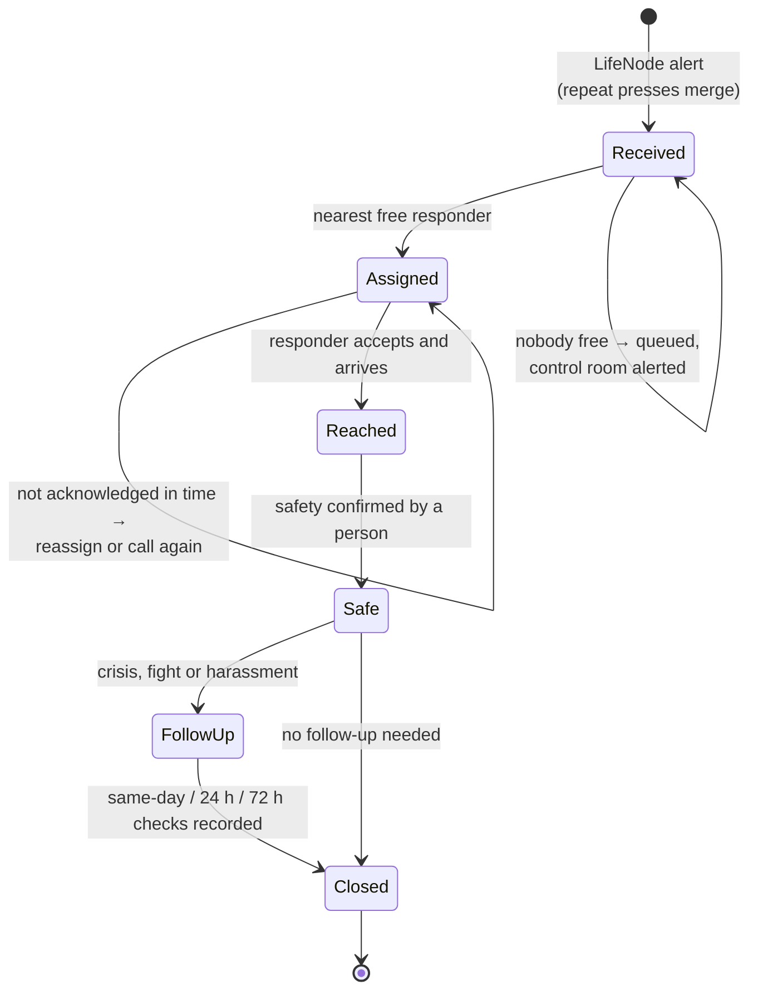

# Closed-loop response flow

The system is not successful when an alert is sent. It is successful only when help reaches the student and safety is verified by a person.



## Sequence for a crisis alert

```mermaid
sequenceDiagram
    autonumber
    participant N as LifeNode (terrace access)
    participant B as LifeGrid backend
    participant P as Nearest patrol
    participant C as Counselling on call
    participant R as Control room

    N->>B: LG1;H1-N3;CRS;1;0*..
    B->>B: check frame, open case (priority 1, high-risk node)
    B->>P: assign case with exact location
    B->>C: notify (crisis protocol)
    B->>R: notify
    B-->>N: stage 1 (received)
    P->>B: accept
    B-->>N: stage 2 (help on the way)
    P->>B: reached
    P->>B: safety confirmed
    C->>B: care notes (visible to counselling only)
    B->>C: same-day, 24 h and 72 h follow-ups scheduled
    C->>B: follow-ups recorded
    R->>B: close case
    B-->>N: stage 3 (closed)
```

## Rules the code enforces

- An alert is **never dropped**. Repeats from the same node and category within two minutes join the open case.
- A case **cannot be marked safe** before a responder has reached it, and **cannot close** before safety is confirmed and every follow-up is recorded.
- If the assigned responder does not acknowledge in time, the case moves to the next free responder, or the control room calls the responder again. Cases not reached in time go to admin escalation.
- When every responder is busy, the case is queued and handed to the first responder who becomes free, most urgent first.
- **False alarms are classified only after safety is secured**, so misuse never blocks help.
